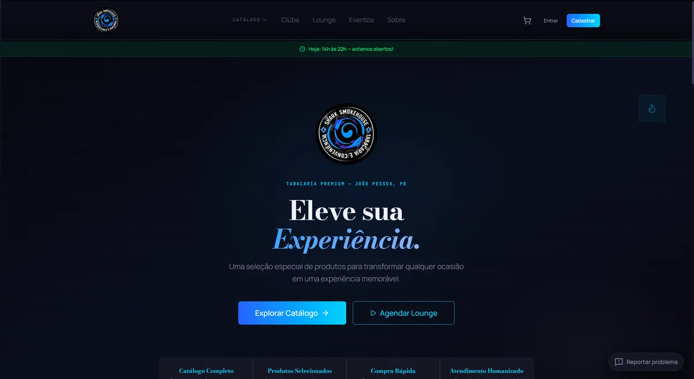
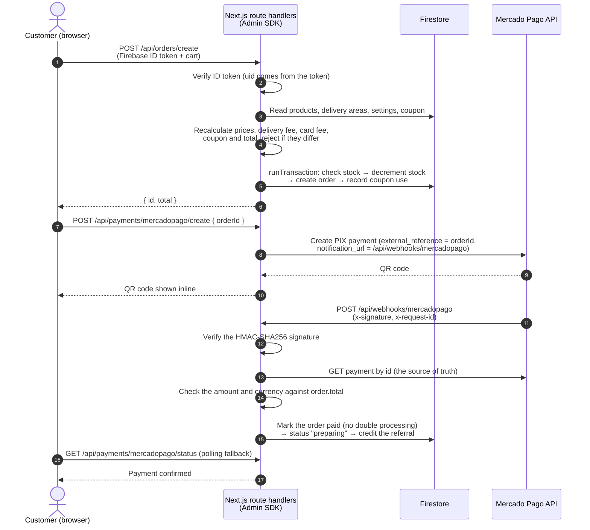

# Shark Smokehouse

🇬🇧 English · 🇧🇷 [Versão em português](./README.pt-BR.md)

**Full-stack e-commerce, point of sale and CRM for a tobacco shop and hookah lounge, built with Next.js 16 and Firebase.**

[](https://shark-smoke-house.vercel.app)


> **In production.** This is the live system of a real business: it takes online orders and PIX payments, runs the in-store point of sale and handles the shop's loyalty club and marketing. It is deployed on Vercel at [shark-smoke-house.vercel.app](https://shark-smoke-house.vercel.app).



---

## Features

### Storefront and checkout
- Landing page with configurable sections, a featured product showcase, business-hours banner, events and lounge sections, and a promo popup
- Catalog with product variations (flavor, scent or color) that each have their own SKU, stock and gallery, plus a product modal and a persistent cart drawer
- Age gate, login, registration and password reset by email
- **Server-side checkout** (`POST /api/orders/create`): the server recalculates item prices, delivery fee by neighborhood, card fee and installments, coupon discount and total, and rejects the order if any value differs from what the client sent
- Orders placed outside business hours are automatically queued as *reserved* and released when the store opens
- Order history and live order tracking with a status timeline and the courier's shared location
- Hookah lounge booking with atomic time-slot locking, plus an events page

### Payments
- PIX through **Mercado Pago**: the QR code is shown inline in the checkout and the client polls the payment status as a fallback
- Payment confirmation through the **Mercado Pago webhook**: the payment is re-fetched from the Mercado Pago API and the amount and currency are checked before an order is marked as paid
- Manual payment methods: manual PIX key, card on delivery or card machine (credit, debit, installments with a configurable fee table), cash on delivery, and WhatsApp-arranged purchases with a customer confirmation step
- Payments, PIX key and fee settings managed from the admin panel

### Loyalty (Clube Shark)
- Four tiers based on point balance: *Baby Shark*, *Hunter Shark*, *Predatory Shark* and *Megalodon*, with a higher earn rate per R$ at each tier
- Welcome bonus, birthday bonus for the top tiers, and points that expire after 180 days, all run by a daily cron job
- Point redemption through a server-side transaction (`POST /api/loyalty/redeem`)
- Referral program: the referrer is credited on the server only after the referred customer's first **paid** order
- Double-points products and categories

### Point of sale and operations
- In-store **POS** with barcode scanner support (HID), quick product search, a built-in calculator and quick sign-up for walk-in customers
- Credit, partial and pending sales with due dates, plus a **receivables** screen
- Manual discounts (a reason is required), coupons, delivery later, and loyalty points credited when the sale is paid
- Seller commissions, a seller dashboard, and sale cancellation that reverses stock and points (admin only)
- Inventory with low-stock alerts and typed stock movements (in, out, adjustment, loss)
- Courier area: a pool of open deliveries that couriers can claim, plus location sharing for tracking
- Bulk product import from CSV or Excel

### Admin dashboard
- Overview metrics, revenue chart, new-order alerts (sound, system notification and toast) and a list of orders stuck too long in one status
- Order management with a status funnel that cannot move backwards, stock reversal on cancellation, and ready-made WhatsApp notifications
- **Financial / BI** reports that combine POS and online sales: gross revenue, cash received, receivables, cost of goods and projected or realized profit, product rankings and data export
- Product costs and taxes are stored in a staff-only collection, away from the public product document
- Management of coupons (percentage or fixed, minimum order value, expiry, per-CPF limit, categories), delivery fees by neighborhood, events, announcements, reviews, users and roles, and lounge schedule and flavors
- **Operations center**: user-submitted issue reports, service health checks (API, Firestore, Mercado Pago, Cloudinary, Resend, cron), request, webhook and cron metrics, and system alerts by severity

### Marketing automations
- Contact base with purchase metrics and a CSV export that protects against CSV injection. Customers who opted out of marketing are excluded
- Rule-based, manual and preset segments (VIP, at risk, lost, birthday, first purchase, abandoned cart, expiring points and more)
- Campaigns sent as in-app notifications or WhatsApp `wa.me` links, with message placeholders, optional coupons and metrics (sends, clicks, coupon use, revenue)
- **Daily automations** run by cron: welcome, first purchase, birthday, abandoned cart, expiring points, VIP, win-back and product promotion. When a customer qualifies for several on the same day, only the highest-priority one is sent. Each run is recorded and never processed twice, and the automations can create a fixed coupon per customer

---

## Architecture

There are no client-side writes for anything that involves money. Orders, redemptions, status changes and payment confirmations go through Next.js route handlers, which use the Firebase Admin SDK. The Firestore rules block clients from creating orders directly (`allow create: if false`).



Background jobs are run by Vercel Cron (`vercel.json`), and each one is protected by `CRON_SECRET`:

| Route | Purpose |
|---|---|
| `/api/cron/orders-queue` | Releases *reserved* orders once the store is open |
| `/api/cron/loyalty-maintenance` | Expires points and grants birthday bonuses |
| `/api/cron/marketing` | Runs scheduled campaigns and automations |

---

## Security highlights

- **The server sets the prices.** The checkout total is recalculated from the catalog and settings (`checkOrderPricing`). If it differs from the client's value, the order is rejected and an error is logged. The payment record is built on the server, and its initial status is never "paid".
- **Atomic writes.** Stock checks, stock decrements, order creation and coupon use happen in a single Firestore transaction. Loyalty redemptions, order status changes and POS sales also run in transactions.
- **Webhook verification.** The `x-signature` header is checked with HMAC-SHA256 and a timing-safe comparison when `MERCADOPAGO_WEBHOOK_SECRET` is set. The body of the notification is never trusted: the payment is always re-fetched from the Mercado Pago API, payment IDs must be numeric, and a payment that is short or in another currency is blocked and raises a critical alert.
- **Role-based access** (`customer`, `seller`, `motoboy`, `admin`) is enforced in three places:
  - in `firestore.rules`, using field-level `diff().affectedKeys()` checks. For example, customers can't change their own role or raise their points, and couriers can only update location fields;
  - in server routes, which verify the ID token and read the role from `users/{uid}`;
  - in `src/proxy.ts`, which redirects to the login page when there is no session cookie.
- Cron routes refuse every request in production when `CRON_SECRET` is not set. Server-only secrets never use the `NEXT_PUBLIC_` prefix.

---

## Tech stack

| Layer | Technology |
|---|---|
| Framework | Next.js 16 (App Router), React 19, TypeScript 5 |
| UI | Tailwind CSS 4, Radix UI, framer-motion, lucide-react |
| State | Zustand 5 (persisted cart) |
| Backend | Firebase Auth, Firestore and Storage on the client, plus the Firebase Admin SDK in route handlers |
| Payments | Mercado Pago (PIX + webhooks) |
| Images | Cloudinary uploads + a custom `next/image` loader |
| Email | Resend (password reset) |
| Spreadsheets | SheetJS (`xlsx`) for import |
| Testing | Vitest 4 + jsdom |
| Hosting | Vercel (including Vercel Cron) |

---

## Project structure

```
src/
├─ app/
│  ├─ catalog/, cart/, checkout/, orders/, clube/, account/, lounge/, events/   storefront pages
│  ├─ motoboy/        courier delivery pool
│  ├─ admin/          dashboard + ~20 areas (orders, sales/POS, inventory, financial, marketing…)
│  └─ api/            orders, payments/mercadopago, webhooks, loyalty, coupons, cron, health, metrics
├─ components/        ui, shop, checkout, landing, orders (tracking), admin (POS, BI, ops)
├─ lib/
│  ├─ firebase/       data access per collection (*.server.ts = Admin SDK)
│  ├─ payments/       Mercado Pago, pricing, webhook signature, installments
│  ├─ loyalty/        tiers and redemption rules
│  ├─ marketing/      segmentation, automation planner, metrics, WhatsApp
│  └─ bi/             financial aggregations
├─ stores/            Zustand stores (cart, auth, site settings, toasts)
├─ hooks/             useAuth, useBarcodeScanner, useNewOrderAlerts
└─ proxy.ts           route protection
firestore.rules       role-based security rules
vercel.json           cron schedules
```

---

## Getting started

**Prerequisites:** Node.js 20+, a Firebase project (Auth + Firestore), and optionally a Mercado Pago, Cloudinary and Resend account.

```bash
git clone https://github.com/Jpsoaresfig/Shark_SmokeHouse.git
cd Shark_SmokeHouse
npm install
```

Create a `.env.local` file in the project root:

```env
# Firebase (client)
NEXT_PUBLIC_FIREBASE_API_KEY=
NEXT_PUBLIC_FIREBASE_AUTH_DOMAIN=
NEXT_PUBLIC_FIREBASE_PROJECT_ID=
NEXT_PUBLIC_FIREBASE_STORAGE_BUCKET=
NEXT_PUBLIC_FIREBASE_MESSAGING_SENDER_ID=
NEXT_PUBLIC_FIREBASE_APP_ID=
NEXT_PUBLIC_FIREBASE_MEASUREMENT_ID=

# Firebase Admin SDK (server only, service account)
FIREBASE_PROJECT_ID=
FIREBASE_CLIENT_EMAIL=
FIREBASE_PRIVATE_KEY=

# Cloudinary (unsigned upload preset)
NEXT_PUBLIC_CLOUDINARY_CLOUD_NAME=
NEXT_PUBLIC_CLOUDINARY_UPLOAD_PRESET=

# Public URLs
NEXT_PUBLIC_APP_URL=http://localhost:3000
NEXT_PUBLIC_SITE_URL=http://localhost:3000

# Mercado Pago (optional, turns on online PIX; server only)
MERCADOPAGO_ACCESS_TOKEN=
MERCADOPAGO_WEBHOOK_SECRET=

# Cron jobs (required in production)
CRON_SECRET=

# Resend (password reset email)
RESEND_API_KEY=
RESEND_FROM=
```

Deploy the Firestore rules and indexes, then start the app:

```bash
npx firebase deploy --only firestore:rules,firestore:indexes
npm run dev        # http://localhost:3000
```

| Script | Description |
|---|---|
| `npm run dev` | Start the development server |
| `npm run build` | Build for production |
| `npm run start` | Serve the production build |
| `npm run lint` | Run ESLint |
| `npm test` | Run the test suite once |
| `npm run test:watch` | Run the tests in watch mode |

For production, set the Mercado Pago webhook to `https://YOUR_DOMAIN/api/webhooks/mercadopago`.

---

## Testing

The project has **30 Vitest test files** (`src/**/*.test.ts`). They cover the core business logic: checkout pricing, webhook signature verification, stock, the cart store, coupons, CPF validation, loyalty tiers and redemption, lounge booking, business hours, order status rules and tracking, CSV and spreadsheet import, POS helpers, BI aggregations and periods, and the marketing modules (segmentation, planner, priorities, metrics, placeholders, WhatsApp, analytics).

```bash
npm test
```

---

## Author

**João Pedro Soares**

- Portfolio: [my-profile-hazel-one.vercel.app](https://my-profile-hazel-one.vercel.app)
- LinkedIn: [linkedin.com/in/joaopedrosoaresfigueiredo](https://www.linkedin.com/in/joaopedrosoaresfigueiredo)
- Email: [jpbusinesss@hotmail.com](mailto:jpbusinesss@hotmail.com)
